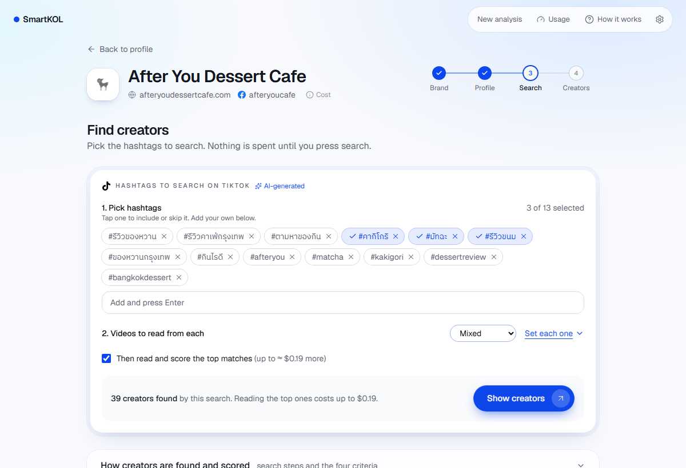
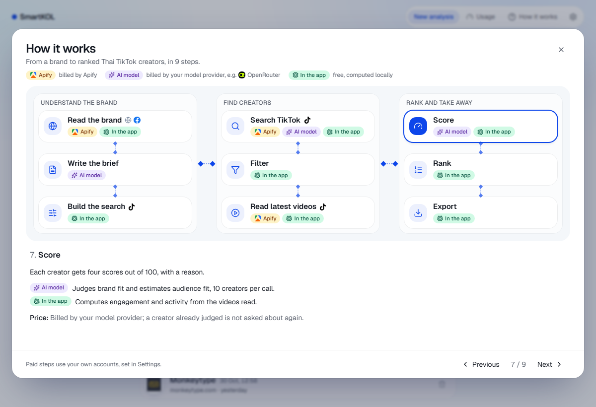

# SmartKOL

Finds, scores and ranks the Thai TikTok creators (KOLs) that fit a brand, starting from its website and Facebook page.

## Overview
Picking creators for a brand is slow: someone opens profile after profile and decides by feel. SmartKOL reads the brand, searches TikTok for creators who match it, reads their recent videos, and gives each one a score with a reason. You get a ranked list with profile links in minutes, and a CSV to take away.

## Look



## Key features
- Reads a brand from a website, a Facebook page, or both, and writes a brief you can edit
- Searches TikTok by hashtag, with filters for Thai captions, creators only (no shops), and size
- Scores every creator on brand fit, engagement, audience fit and activity, with the reason shown
- Shows the price before every paid step; a repeat search costs nothing
- Ranked table or cards, a page per creator, and a CSV export
- You bring your own Apify and model accounts; nothing runs on a shared key

## Quick start
```bash
git clone <repo-url> smartkol && cd smartkol
docker compose up --build
# open http://localhost:3000, then Settings: add your Apify token and a model (or "Connect with OpenRouter")
```
You need Docker and an [Apify](https://apify.com) account (the free plan is enough to try it). Keys can also go in `credential/.env` (copy `credential/.env.example`); the file is git-ignored.

## How it works
- Website or Facebook link → brand brief (AI) → hashtags you pick → TikTok search (Apify) → filters → latest videos of the top creators (Apify) → scores (AI + the app's own math) → ranked list and CSV
- Four scores out of 100: **brand fit** (the AI judges category, style, products and brand safety), **engagement** (likes, comments and shares per view, compared with creators of a similar size), **audience fit** (an AI estimate) and **activity** (how often and how recently they post, ads, steady views)
- Suggested weights are 40 / 25 / 20 / 15. You can change them and the ranking updates for free
- The **How it works** button in the app shows every step and who does it

## What it costs
Apify bills the data: a Facebook page about $0.06, TikTok $0.0037 per video plus $0.001 a run (reading 10 creators × 5 videos is about $0.19). The model is billed by its provider and is a fraction of a cent for a scoring run in our tests. The app shows the price first and saves Apify results for 7 days.

## Tech stack
- Next.js + TypeScript + Tailwind (frontend), FastAPI + SQLite (backend), Playwright for websites, Apify for Facebook and TikTok data, any OpenAI- or Anthropic-style model (OpenRouter by default). Details are in `PROJECT.md`

## Repo layout
- `frontend/` — the web app
- `backend/` — the API, the pipeline and its tests (`backend/tests`)
- `docs/` — screenshots
- `credential/` — your keys (git-ignored, only `.env.example` is tracked)

## Limitations
- **Audience is a guess.** TikTok does not publish who watches a creator, so audience fit and the likely age, gender and interests are the model's estimate from content, and labelled that way
- A hashtag search shows one video per creator, so how recently someone posts is only judged after their videos are read
- The model can score the same creator slightly differently on another run
- Thai creators on TikTok only; the app is in English and runs on one machine for one user
- Apify's scrapers are third-party and can change; one search reads at most 500 videos

## Privacy and ethics
- Only public data is used. Nothing needs a login, and no one is contacted
- A bio is shown as the creator posted it, so the contact details they publish for work enquiries are there, and the CSV has a column for them. Phone numbers and e-mails are hidden in video captions and are never sent to the AI model
- Pictures are fetched and kept by the server, not loaded from TikTok by your browser
- Your keys are encrypted on disk and never shown in full. Deleting an analysis removes it
- Scores are a suggestion for a person to review. Brand-safety problems and ad-heavy or odd accounts are flagged, and every estimate is marked

## Run the tests
```bash
cd backend && python -m unittest discover -s tests -t .
cd frontend && npx tsc --noEmit && npx eslint .
```

## Sources and credits
- Data: Apify actors [apify/facebook-pages-scraper](https://apify.com/apify/facebook-pages-scraper), [apify/facebook-posts-scraper](https://apify.com/apify/facebook-posts-scraper) and [clockworks/tiktok-scraper](https://apify.com/clockworks/tiktok-scraper). TikTok's official APIs are open only to approved partners and researchers, which is why a scraper is used
- Built with [Playwright](https://playwright.dev), [FastAPI](https://fastapi.tiangolo.com), [Next.js](https://nextjs.org), [Tailwind CSS](https://tailwindcss.com), [shadcn/ui](https://ui.shadcn.com) and [Lucide](https://lucide.dev); models through [OpenRouter](https://openrouter.ai) (sign-in uses its OAuth PKCE flow)
- The Facebook and TikTok marks are from [Simple Icons](https://simpleicons.org) (CC0)

## Documents
- `PROJECT.md` — scope, features and how each one is checked, tech stack
- `AGENTS.md` — working rules for the AI agent that helped build this

## AI disclosure
- This project was built with an AI coding agent, Claude Code (rules in `AGENTS.md`). Inside the app, a language model you choose writes the brand brief and judges brand fit and audience; those parts are labelled in the interface
